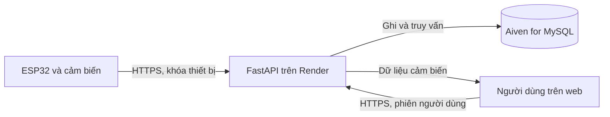

# Sensor Data Bridge — nền tảng IoT cho ESP32

Sensor Data Bridge là dự án xây dựng nền tảng thu thập và theo dõi dữ liệu cảm biến theo hướng tương tự ThingSpeak. ESP32 gửi số đo qua HTTP API; backend kiểm tra, lưu trữ và cung cấp dữ liệu cho dashboard hoặc các ứng dụng khác. **Pepper Nursery** (giám sát môi trường vườn ươm cây ớt) là bài toán thử nghiệm đầu tiên. Dự án hướng tới việc để sinh viên CTUT có thể đăng ký thiết bị và theo dõi các kênh dữ liệu của mình.

README này mô tả **hướng triển khai đã điều chỉnh** từ [tài liệu kế hoạch v0.1](CTUT_IoT_Tai_lieu_du_an_v0_1.md) và **trạng thái thực tế của repository**. Những mục ghi *dự kiến* chưa phải chức năng đã có.

## Kiến trúc mục tiêu



- **FastAPI trên Render** là API trung gian giữa ESP32, cơ sở dữ liệu và giao diện. ESP32 không kết nối trực tiếp tới Aiven.
- **Aiven for MySQL** hiện lưu các số đo cảm biến. Bảng cho tài khoản, dự án và thiết bị là phần phát triển tiếp theo.
- **React + Vite** cung cấp dashboard thử nghiệm. Trong bản hiện tại, giao diện làm mới dữ liệu bằng cách gọi API mỗi 5 giây.
- Giao thức ưu tiên cho ESP32 ở giai đoạn đầu là HTTP/HTTPS. Thư viện Arduino cho ESP32, xử lý retry/chống trùng và firmware Pepper Nursery là các phần cần phát triển tiếp.

Phương án máy chủ Oracle ban đầu đã được thay bằng **Render để chạy FastAPI** và **Aiven for MySQL để lưu dữ liệu**. Tài liệu v0.1 có các đề xuất cũ về framework backend, nơi vận hành và xác thực; khi có khác biệt, README này phản ánh quyết định hiện tại.

## Phạm vi MVP thử nghiệm

MVP đầu tiên tập trung vào một luồng khép kín: người dùng đăng ký/đăng nhập, cấu hình thiết bị, ESP32 gửi dữ liệu, backend lưu dữ liệu và dashboard hiển thị số đo. Để thử nhanh, luồng đăng ký/đăng nhập dự kiến **chỉ yêu cầu nhập địa chỉ email**; chưa dùng Google OAuth, liên kết xác minh email, OTP hoặc mật khẩu. Đây là cách nhận diện tạm thời cho môi trường thử nghiệm, **không chứng minh người nhập sở hữu email**. Trước khi mở cho người dùng ngoài nhóm thử nghiệm, cần bổ sung xác thực thực sự và phân quyền truy cập dữ liệu.

| Hạng mục | Hiện có trong repository | Mục tiêu MVP |
| --- | --- | --- |
| API FastAPI | Health check, đo đơn lẻ (legacy), API tài khoản, dự án, thiết bị và telemetry V1 | Mở rộng tổng hợp aggregate và phân trang cursor |
| Lưu trữ | Quản lý qua Alembic: `users`, `projects`, `devices`, `device_tokens`, `telemetry_records` và `sensor_readings` | Bổ sung chính sách lưu trữ và backup |
| Đăng ký/đăng nhập | Đã có: Nhập email nhận JWT Bearer token để thử nghiệm MVP | Bổ sung Google OAuth / OTP khi đưa vào sử dụng rộng rãi |
| Bảo vệ API | Đã có: Khóa riêng thiết bị (Device Token SHA-256), phân quyền dữ liệu theo chủ sở hữu (User JWT) | Phân quyền chi tiết (RBAC) theo vai trò thành viên |
| Dashboard | Xem số đo và gửi mẫu mô phỏng đơn lẻ (legacy) | Nâng cấp quản lý thiết bị, xem số đo mới nhất/lịch sử theo trạm đa chỉ số |
| ESP32 và thư viện Arduino | Chưa có trong repository | Gửi dữ liệu cảm biến qua API; có ví dụ tích hợp |
| Render | Hướng dẫn cấu hình triển khai | Chạy dịch vụ FastAPI live |

Các tính năng như biểu đồ nâng cao, CSV, SSE, tổng hợp dữ liệu, chính sách lưu lịch sử, ứng dụng mobile, MQTT, OTA và điều khiển tưới là hướng phát triển tiếp theo. Mục tiêu tải 50–100 thiết bị gửi mỗi 1–5 giây trong tài liệu v0.1 **chưa được kiểm chứng** trên Render/Aiven; cần thử tải trước khi công bố khả năng hỗ trợ.

## Cấu trúc repository

```text
.
├── backend/
│   ├── app/
│   │   ├── api/v1/endpoints/   # Health và sensor readings
│   │   ├── core/               # Cấu hình và kết nối MySQL
│   │   ├── schemas/sensor.py   # Cấu trúc số đo hiện tại
│   │   ├── services/           # Ghi/đọc số đo trong MySQL
│   │   └── main.py             # FastAPI app
│   ├── tests/                  # Kiểm thử API cơ bản
│   ├── .env.example
│   └── requirements.txt
├── frontend/
│   ├── src/                    # React dashboard và API client
│   ├── .env.example
│   └── package.json
├── .github/workflows/ci.yml    # Pytest và Vite build
└── CTUT_IoT_Tai_lieu_du_an_v0_1.md
```

## Chạy bản hiện tại trên máy cá nhân

Ví dụ dưới đây dùng **PowerShell** từ thư mục gốc của repository. Cần Python 3.12 hoặc 3.13 (CI dùng 3.12; máy phát triển này đã thử với 3.13), Node.js 22 và npm. Chạy backend và frontend ở hai terminal riêng.

### 1. Backend

```powershell
py -3.13 -m venv backend\.venv
.\backend\.venv\Scripts\python.exe -m pip install -r backend\requirements.txt
if (-not (Test-Path backend\.env)) { Copy-Item backend\.env.example backend\.env }
Set-Location backend
.\.venv\Scripts\python.exe -m uvicorn app.main:app --reload --host 127.0.0.1 --port 8000
```

Các địa chỉ sau sẽ khả dụng khi backend chạy:

- API: `http://127.0.0.1:8000/api/v1`
- Kiểm tra tiến trình: `http://127.0.0.1:8000/api/v1/health`
- Tài liệu API tương tác: `http://127.0.0.1:8000/docs`

Trước khi chạy, điền `MYSQL_HOST`, `MYSQL_PORT`, `MYSQL_DATABASE`, `MYSQL_USER`, `MYSQL_PASSWORD` và `MYSQL_SSL_CA` trong `backend/.env`. `MYSQL_SSL_CA` phải trỏ tới tệp CA của dự án Aiven; đường dẫn tương đối được tính từ thư mục `backend`. Backend xác minh cả chứng chỉ và tên máy chủ. Lúc khởi động, ứng dụng chạy `CREATE TABLE IF NOT EXISTS` cho bảng `sensor_readings`, nên tài khoản MySQL cần quyền `CREATE` khi khởi động. `/health` trả `503` nếu không kết nối được DB. Các biến khác gồm `APP_NAME`, `ENVIRONMENT`, `HOST`, `PORT` và `BACKEND_CORS_ORIGINS` (xem `backend/.env.example`). `HOST`/`PORT` trong tệp cấu hình không tự thay thế tham số `--host`/`--port` của lệnh Uvicorn.

### 2. Frontend

Trong terminal mới, từ thư mục gốc:

```powershell
Set-Location frontend
npm ci
npm run dev
```

Mở `http://localhost:5173`. Khi phát triển cục bộ, Vite chuyển tiếp các request `/api` tới backend tại `http://127.0.0.1:8000`, nên có thể chạy mà không cần tạo `frontend/.env`. Nếu đặt `VITE_API_BASE_URL`, giá trị phải là URL đầy đủ tới tiền tố `/api/v1` của backend; khi frontend và backend khác origin, cấu hình `BACKEND_CORS_ORIGINS` tương ứng ở backend.

### 3. Thử gửi một số đo

Khi backend đang chạy, dùng một terminal PowerShell khác:

```powershell
$reading = @{
    sensor_id = "ESP32_01"
    sensor_type = "temperature"
    value = 28.5
    unit = "C"
    metadata = @{ location = "Pepper Nursery" }
} | ConvertTo-Json -Depth 3

Invoke-RestMethod -Uri "http://127.0.0.1:8000/api/v1/sensors/readings" `
    -Method Post -ContentType "application/json" -Body $reading

Invoke-RestMethod -Uri "http://127.0.0.1:8000/api/v1/sensors/readings/ESP32_01"
```

`timestamp` có thể bỏ qua; backend sẽ điền thời gian UTC. Dashboard cũng có nút **Simulate Reading** để gửi dữ liệu mẫu. Mẫu trên phản ánh **API đang chạy**: mỗi request chứa một `sensor_id`, `sensor_type`, `value`, `unit`, `timestamp` tùy chọn và `metadata` tùy chọn. Nó chưa phải hợp đồng nhiều trường đo trong một bản tin được đề xuất ở tài liệu v0.1.

## API hiện có

### 1. Dành cho Thiết bị IoT (ESP32)

Yêu cầu header: `Authorization: Bearer <DEVICE_TOKEN>`

| Phương thức | Đường dẫn | Tác dụng |
| --- | --- | --- |
| `POST` | `/api/v1/telemetry` | Nhận bản tin đa chỉ số V1, kiểm tra time window, chống ghi trùng lặp idempotency |

### 2. Dành cho Người dùng & Dashboard (Web / Mobile)

Yêu cầu header: `Authorization: Bearer <USER_ACCESS_TOKEN>` (sau khi đăng nhập)

| Phương thức | Đường dẫn | Tác dụng |
| --- | --- | --- |
| `POST` | `/api/v1/auth/login` | Đăng nhập/đăng ký bằng Email thử nghiệm, trả về JWT Token |
| `GET` | `/api/v1/auth/me` | Lấy thông tin tài khoản hiện tại |
| `GET`, `POST` | `/api/v1/projects` | Danh sách và tạo dự án mới |
| `GET`, `PATCH` | `/api/v1/projects/{id}` | Xem chi tiết hoặc cập nhật dự án |
| `GET`, `POST` | `/api/v1/projects/{id}/devices` | Danh sách thiết bị và tạo trạm mới (cấp Device Token) |
| `GET`, `PATCH` | `/api/v1/devices/{id}` | Xem chi tiết hoặc sửa cấu hình trạm |
| `POST` | `/api/v1/devices/{id}/tokens` | Cấp token mới cho thiết bị |
| `DELETE` | `/api/v1/devices/{id}/tokens/{tokenId}` | Thu hồi token thiết bị |
| `GET` | `/api/v1/devices/{id}/latest` | Lấy số đo mới nhất các cảm biến của trạm |
| `GET` | `/api/v1/devices/{id}/telemetry?limit=50` | Xem lịch sử các lần đo của trạm |

### 3. Hệ thống & Đo đơn lẻ (Legacy)

| Phương thức | Đường dẫn | Tác dụng |
| --- | --- | --- |
| `GET` | `/` | Thông tin ứng dụng và đường dẫn tài liệu |
| `GET` | `/api/v1/health` | Kiểm tra kết nối MySQL; trả `503` khi DB không khả dụng |
| `POST` | `/api/v1/sensors/readings` | Nhận một số đo đơn lẻ (legacy) |
| `GET` | `/api/v1/sensors/readings?limit=50` | Đọc các số đo gần đây (legacy) |
| `GET` | `/api/v1/sensors/readings/{sensor_id}?limit=50` | Đọc theo sensor ID (legacy) |

## Triển khai mục tiêu với Render và Aiven

1. **Backend trên Render:** tạo Web Service từ repository, đặt **Root Directory** là `backend`, Build Command là `pip install -r requirements.txt`, Start Command là `uvicorn app.main:app --host 0.0.0.0 --port $PORT`. Render hướng dẫn dùng `$PORT` và lắng nghe trên `0.0.0.0` cho Web Service. [Tài liệu Render về FastAPI](https://render.com/docs/deploy-fastapi), [Root Directory cho repository nhiều ứng dụng](https://render.com/docs/your-first-deploy).
2. **Cơ sở dữ liệu trên Aiven:** cấu hình sáu biến `MYSQL_*` trên Render và bảo đảm tệp CA có tại vị trí `MYSQL_SSL_CA` trong bản triển khai. Mã hiện dùng PyMySQL, bắt buộc xác minh TLS và tự tạo bảng `sensor_readings` khi khởi động. Chưa có migration quản lý thay đổi schema. [Hướng dẫn kết nối Python của Aiven](https://aiven.io/docs/products/mysql/howto/connect-with-python), [tài liệu TLS của Aiven](https://aiven.io/docs/platform/concepts/tls-ssl-certificates).
3. **Frontend:** khi triển khai riêng, đặt `VITE_API_BASE_URL` thành `https://<dia-chi-backend>/api/v1` tại thời điểm build và thêm origin của frontend vào `BACKEND_CORS_ORIGINS`. Các biến `VITE_` đi vào mã chạy trên trình duyệt, nên không đặt thông tin Aiven hoặc khóa bí mật tại đây.
4. **Trước khi mở truy cập rộng:** hoàn thiện đăng nhập, phân quyền, khóa thiết bị, migration và sao lưu. API hiện vẫn công khai thao tác gửi/đọc số đo.

Thông tin kết nối Aiven, token và khóa thiết bị chỉ lưu trong môi trường chạy hoặc tệp `.env` cục bộ; không commit vào Git. Tệp CA là chứng chỉ công khai nhưng phải có trên môi trường triển khai. Các thay đổi schema tiếp theo cần được quản lý bằng migration.

## Kiểm tra chất lượng

Từ thư mục gốc, chạy:

```powershell
Set-Location backend
.\.venv\Scripts\python.exe -m pytest
```

```powershell
Set-Location frontend
npm ci
npm run build
```

GitHub Actions hiện chạy kiểm thử backend và build frontend trên các nhánh `main`/`master` khi push hoặc tạo pull request. Bộ kiểm thử hiện chỉ bao phủ root, health và một luồng gửi/đọc số đo cơ bản; chưa xác nhận yêu cầu MVP mới hoặc khả năng chịu tải.

## Các bước phát triển tiếp theo

1. Chốt hợp đồng dữ liệu giữa ESP32, FastAPI và dashboard; xác định cách gửi nhiều chỉ số trong một bản tin, timestamp và mã chống trùng. **Đã thêm schema v1 và ví dụ** tại [`docs/contracts/`](docs/contracts/README.md), cùng kiểm tra hợp lệ/hash tại `backend/app/schemas/telemetry.py`. Còn cần thống nhất danh sách trường/đơn vị theo dự án và tích hợp endpoint sau khi có thiết bị, khóa và migration.
2. Bổ sung migration, bảng tài khoản/dự án/thiết bị và chính sách sao lưu trên Aiven for MySQL.
3. Xây luồng tài khoản thử nghiệm bằng email, sau đó quản lý dự án, thiết bị và khóa gửi dữ liệu. Trước khi mở truy cập rộng, thay cách nhận diện email tạm thời bằng xác thực có kiểm chứng.
4. Viết ví dụ ESP32/Arduino, kiểm tra gửi lại khi mất mạng, dữ liệu lỗi và quyền truy cập chéo giữa tài khoản.
5. Thử tải và đo độ trễ end-to-end trên cấu hình Render/Aiven thực tế trước khi xác nhận hạn mức thiết bị, chu kỳ gửi và thời gian lưu dữ liệu.

Chi tiết yêu cầu ban đầu, mô hình dữ liệu và các kịch bản kiểm thử được lưu trong [tài liệu kế hoạch v0.1](CTUT_IoT_Tai_lieu_du_an_v0_1.md). Các đề xuất trong tài liệu đó cần được đối chiếu với những thay đổi nêu ở README này trước khi triển khai.
