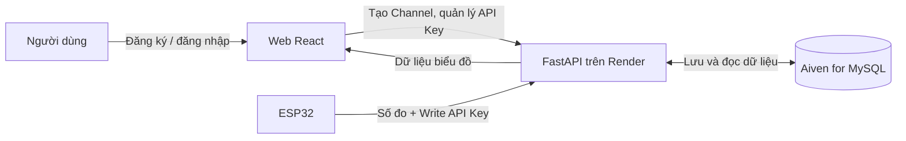

# Sensor Data Bridge — Nền tảng IoT theo mô hình ThingSpeak

**Sensor Data Bridge** là nền tảng đơn giản để người dùng tạo **Channel**, gửi dữ liệu cảm biến từ ESP32 và xem dữ liệu dưới dạng biểu đồ. Cách tổ chức giao diện và chức năng tham khảo ThingSpeak, nhưng hệ thống sử dụng backend và cơ sở dữ liệu riêng.

> **Mục tiêu MVP:** Đăng ký/đăng nhập → tạo Channel → lấy Write API Key → ESP32 gửi số đo → xem biểu đồ tại `private_show`. Người dùng cũng có thể tạo và quản lý Read/Write API Key tại `api_keys`.
>
> **Trạng thái:** Backend và frontend Channel MVP đang được triển khai. Backend đã kết nối Aiven; frontend đã có luồng Channels, Private View và API Keys.

## 1. Chức năng MVP

### 1.1. Đăng ký, đăng nhập

- Đăng ký tài khoản bằng **email và mật khẩu**.
- Đăng nhập để xem và quản lý các Channel của chính mình.
- Mỗi tài khoản có thể tạo nhiều Channel; người dùng không được xem Channel riêng tư hoặc API Key của tài khoản khác.

### 1.2. Tạo và quản lý Channel

- Sau khi đăng nhập, người dùng có thể **tạo Channel** và đặt tên, mô tả ngắn (không bắt buộc).
- Mỗi Channel có **Channel ID dạng số** duy nhất do hệ thống tự sinh, ví dụ: `3568980`.
- Mỗi Channel có các trường dữ liệu (`field1`, `field2`, ...) được gán tên theo cảm biến. Ví dụ:
  - `field1`: Nhiệt độ không khí (°C)
  - `field2`: Độ ẩm không khí (%)
  - `field3`: pH đất
- Trang danh sách Channel hiển thị các kênh thuộc tài khoản, cho phép mở trang xem dữ liệu hoặc quản lý khóa API.

### 1.3. Trang `/private_show` — xem dữ liệu cảm biến

**Đường dẫn dự kiến:** `/channels/{channel_id}/private_show`

**Ví dụ:** `/channels/3568980/private_show`

- Chỉ chủ sở hữu Channel đã đăng nhập mới có quyền truy cập.
- Hiển thị **biểu đồ đường riêng cho từng field** đã cấu hình, trục ngang là thời gian và trục dọc là giá trị đo.
- Đọc các bản ghi đã lưu trong cơ sở dữ liệu và có thể tự tải dữ liệu mới theo chu kỳ (polling).
- Hiển thị số bản ghi (Entries) và thời gian nhận dữ liệu gần nhất.
- Nếu Channel chưa có dữ liệu thì hiển thị trạng thái trống, không vẽ dữ liệu giả.

### 1.4. Trang `/api_keys` — quản lý API Key

**Đường dẫn dự kiến:** `/channels/{channel_id}/api_keys`

**Ví dụ:** `/channels/3568980/api_keys`

Mỗi Channel hỗ trợ hai loại khóa:

| Loại khóa | Quyền sử dụng | Mục đích |
| --- | --- | --- |
| **Write API Key** | Ghi dữ liệu vào đúng Channel | ESP32 hoặc phần mềm gửi số đo |
| **Read API Key** | Chỉ đọc dữ liệu của đúng Channel | Ứng dụng hoặc dịch vụ đọc số đo |

- Chủ Channel có thể **tạo khóa mới**, xem danh sách các khóa và **thu hồi/tạo lại** khóa khi cần.
- Không lưu khóa dưới dạng văn bản thuần; secret được mã hóa trong backend và chỉ trả cho chủ Channel khi key còn hoạt động để hỗ trợ sao chép lại.
- API kiểm tra khóa và loại quyền trước khi cho phép đọc hoặc ghi dữ liệu.
- Khóa của Channel này không dùng để truy cập Channel khác.

### 1.5. Nhận dữ liệu từ ESP32

- ESP32 gọi HTTP(S) API kèm **Write API Key** để gửi các giá trị đo vào Channel tương ứng.
- Backend kiểm tra khóa, kiểm tra dữ liệu hợp lệ, lưu giá trị cùng thời điểm nhận vào MySQL.
- Ví dụ **định dạng API đề xuất cho MVP** (chưa phải endpoint hiện có):

```http
POST /api/v1/channels/3568980/feeds
X-API-Key: <WRITE_API_KEY>
Content-Type: application/json
```

```json
{
  "field1": 28.2,
  "field2": 42.5,
  "field3": 6.86
}
```

API đọc dữ liệu tương ứng có thể là `GET /api/v1/channels/3568980/feeds` với **Read API Key**, hoặc qua phiên đăng nhập của chủ Channel. Các đường dẫn và cấu trúc JSON trong mục này là **đề xuất để nhóm thống nhất khi triển khai**.

## 2. Luồng hoạt động cơ bản



**Ví dụ sử dụng:** Đăng nhập → tạo Channel `3568980` → cấu hình `field1` là nhiệt độ, `field2` là độ ẩm → tạo Write API Key → cấu hình ESP32 gửi dữ liệu → mở `/channels/3568980/private_show` để theo dõi các biểu đồ.

## 3. Công nghệ sử dụng

| Thành phần | Công nghệ | Nhiệm vụ |
| --- | --- | --- |
| Frontend | React + Vite | Đăng ký/đăng nhập, danh sách Channel, biểu đồ, trang API Keys |
| Backend | Python + FastAPI | Xác thực tài khoản và API Key, tiếp nhận/truy vấn số đo |
| Cơ sở dữ liệu | Aiven for MySQL | Lưu tài khoản, Channel, API Key và các bản ghi cảm biến |
| Triển khai API | Render | Chạy backend FastAPI |
| Thiết bị | ESP32 | Gửi dữ liệu đo qua HTTP(S) |

Cấu trúc dữ liệu tối thiểu dự kiến gồm `users`, `channels`, `channel_fields`, `api_keys`, `channel_feeds` (tên bảng có thể điều chỉnh khi triển khai).

## 4. Trạng thái repository hiện tại

README này thay thế phạm vi MVP cũ bằng mô hình **Channel**. Các thành phần đã có và chưa có cần được phân biệt:

| Thành phần | Trạng thái hiện tại |
| --- | --- |
| Backend FastAPI, kết nối Aiven MySQL, API health | Đã có |
| Gửi/đọc từng số đo qua API `sensors/readings` | Đã có bản thử nghiệm, **chưa dùng Channel/API Key** |
| React Channel dashboard, Private View và API Keys | Đã triển khai MVP frontend |
| Đăng ký/đăng nhập bằng email và mật khẩu | Đã triển khai |
| Tạo Channel, Channel ID và field | Đã triển khai trong backend |
| `/channels/{id}/private_show` với dữ liệu theo field | Đã triển khai backend và frontend |
| `/channels/{id}/api_keys` và xác thực Read/Write API Key | Đã triển khai |
| ESP32 gửi số đo theo Channel ID | Đã triển khai API `POST /api/v1/channels/{id}/feeds` |

API thử nghiệm hiện có: `GET /api/v1/health`, `POST /api/v1/sensors/readings`, `GET /api/v1/sensors/readings` và `GET /api/v1/sensors/readings/{sensor_id}`. Các API này **chưa có xác thực**, chỉ nên dùng trong môi trường thử nghiệm; không coi chúng là API Channel chính thức.

## 5. Chạy bản thử nghiệm hiện tại

Cần Python 3.12 hoặc 3.13, Node.js 22 và npm. Chạy ở hai cửa sổ PowerShell từ thư mục gốc của repository.

**Backend:**

```powershell
py -3.13 -m venv backend\.venv
.\backend\.venv\Scripts\python.exe -m pip install -r backend\requirements.txt
if (-not (Test-Path backend\.env)) { Copy-Item backend\.env.example backend\.env }
Set-Location backend
.\.venv\Scripts\python.exe -m uvicorn app.main:app --reload --host 127.0.0.1 --port 8000
```

Trước khi chạy, cấu hình các biến `MYSQL_HOST`, `MYSQL_PORT`, `MYSQL_DATABASE`, `MYSQL_USER`, `MYSQL_PASSWORD`, `MYSQL_SSL_CA` trong `backend/.env` theo cơ sở dữ liệu Aiven. Tài liệu API tại `http://127.0.0.1:8000/docs`.

Sau khi cấu hình database, chạy migration:

```powershell
Set-Location backend
.\.venv\Scripts\python.exe -m alembic upgrade head
```

**Frontend** (cửa sổ PowerShell mới, từ thư mục gốc):

```powershell
Set-Location frontend
npm ci
npm run dev
```

Mở `http://localhost:5173` để sử dụng giao diện Channel MVP. Các view `projects/devices/telemetry` cũ vẫn được giữ trong source cho giai đoạn chuyển tiếp.

## 6. Trạng thái roadmap

1. **Backend MVP:** đã hoàn tất tài khoản, Channel/field, Read/Write API Key, feed API và `private_show` API.
2. **Frontend Channel MVP:** đã có đăng nhập, danh sách/tạo Channel, cấu hình field, Private View biểu đồ polling và quản lý API key.
3. **Tiếp theo:** kiểm thử giao diện thực tế, hoàn thiện responsive/UX và triển khai frontend cùng backend trên môi trường production.
4. **Sau MVP:** cân nhắc Public View, chia sẻ Channel, cảnh báo vượt ngưỡng, MQTT và dashboard phân tích nâng cao.

**Ngoài phạm vi MVP:** Public View, chia sẻ Channel, ứng dụng mobile, cảnh báo vượt ngưỡng, MQTT, dashboard phân tích nâng cao và các tính năng quản lý dự án/phân quyền quản trị phức tạp.

> **Lưu ý bảo mật:** Không đưa khóa API thật, mật khẩu hoặc biến môi trường chứa bí mật lên GitHub. Nếu khóa thật đã xuất hiện trong ảnh chụp, tin nhắn hoặc tài liệu được chia sẻ, cần tạo khóa thay thế và thu hồi khóa cũ.
